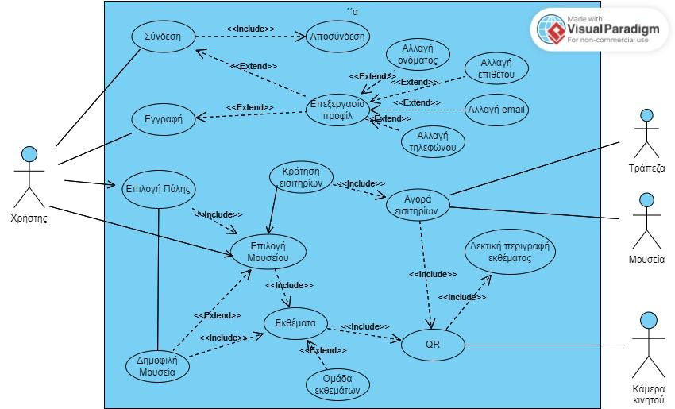
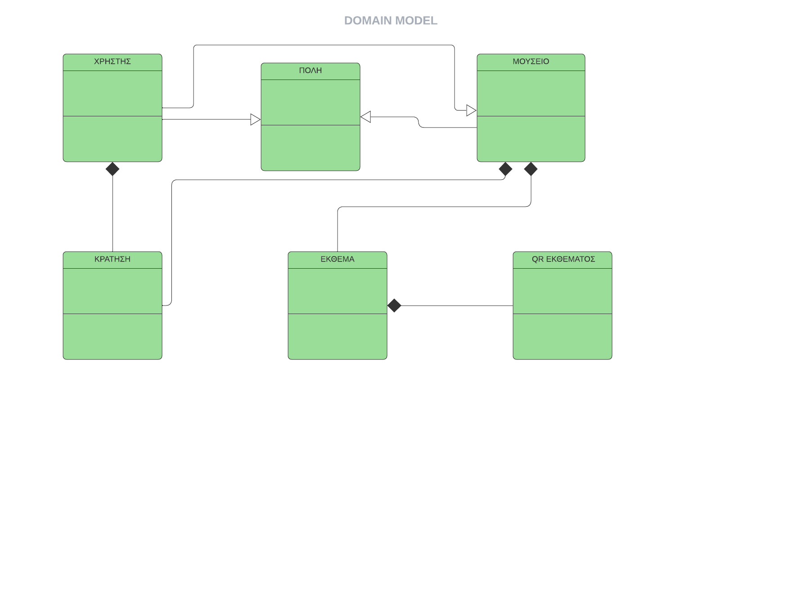

# ArtScribe

A Java desktop application that makes museums more accessible to blind and visually impaired visitors, through **audio-friendly descriptions of exhibits**. Users can browse partner museums, read detailed exhibit descriptions, and book tickets online.

Team project for the *Software Engineering* course (2024), Department of Computer Engineering & Informatics, University of Patras. Built by a team of four.

## Features
- Sign up / sign in
- Edit profile, view and cancel tickets
- Search museums by **city** or **keyword**
- Online ticket reservation (with a simulated payment step)
- QR code scanning of exhibits (prototype, simulated)
- Museum traffic information

## Tech stack
Java (Swing GUI), SQLite via JDBC (`sqlite-jdbc`), developed in Eclipse.

## Project structure
```
src/net/codejava/   # application classes (Menu = entry point, User, Museum, City, Exhibit, Reservation, Bank)
src/ScanQR.java     # standalone QR-scan prototype
db/artscribe.db     # SQLite database with demo data (13 museums, 14 exhibits, 5 cities)
db/schema.sql       # database schema
docs/               # analysis report (PDF), use case diagram, domain model, Gantt chart
```

## How to run
1. Install a JDK (11 or newer).
2. Download the [SQLite JDBC driver](https://github.com/xerial/sqlite-jdbc/releases) (`sqlite-jdbc-*.jar`).
3. In Eclipse: *File → Import → Existing Projects* (or create a Java project and copy `src/`), then add the jar to the build path.
4. Run `net.codejava.Menu`. The working directory must be the project root, so that `db/artscribe.db` is found.

## Demo data
The database contains fictional demo users (`demo.user1@example.com` … `demo.user15@example.com`, password `demo1234`).

## Status and known limitations
This repository is an **academic prototype** and a snapshot of the course project:
- Some SQL queries in the code use table/column names that differ from the schema in `db/schema.sql`, so some features (e.g. keyword search, exhibit lookup, payments) do not work with this database yet.
- QR scanning is simulated and passwords are stored in plain text. Neither should be used in production.
- There are no automated tests.

## Software engineering documentation
The course deliverables (in Greek) are in [`docs/ArtScribe_analysis_report.pdf`](docs/ArtScribe_analysis_report.pdf):
- **Team plan:** Gantt and PERT charts, SCRUM-based way of working
- **Project description and UI mockups** (Figma): login, sign-up, museum and city selection, ticket booking, profile, QR scan
- **Project plan** and cost estimation
- **Risk assessment** (project risks and team risks) with mitigation strategies
- **13 use cases** with main and alternative flows (sign in, sign up, museum search by city / category, ticket booking and purchase, exhibit QR scan, exhibit information, traffic information, profile editing, sign out)
- **Use case diagram** and **domain model**





## Περιγραφή (Greek)
Η εφαρμογή μας αποτελεί έναν καινοτόμο τρόπο ξενάγησης τυφλών ατόμων σε μουσεία, μέσω ηχητικής περιγραφής των εκθεμάτων. Η εφαρμογή περιέχει πλοήγηση σε μουσεία που συνεργάζονται με την ArtScribe, με λεπτομερείς αποδόσεις των εκθεμάτων, ώστε να διευκολύνεται η εμπειρία επίσκεψης και η επαφή με την τέχνη.

## Team

| Name | GitHub |
|---|---|
| Aristea Tempelopoulou | [@AristeaTemp](https://github.com/AristeaTemp) |
| Anna-Gilda Mazaraki | [@Gildamaz](https://github.com/Gildamaz) |
| Despoina Papadopoulou | [@despinapap](https://github.com/despinapap) |
| Ilda Hunci | [@ildahun](https://github.com/ildahun) |

Four-person team project for the course "Software Engineering" (University of Patras)

